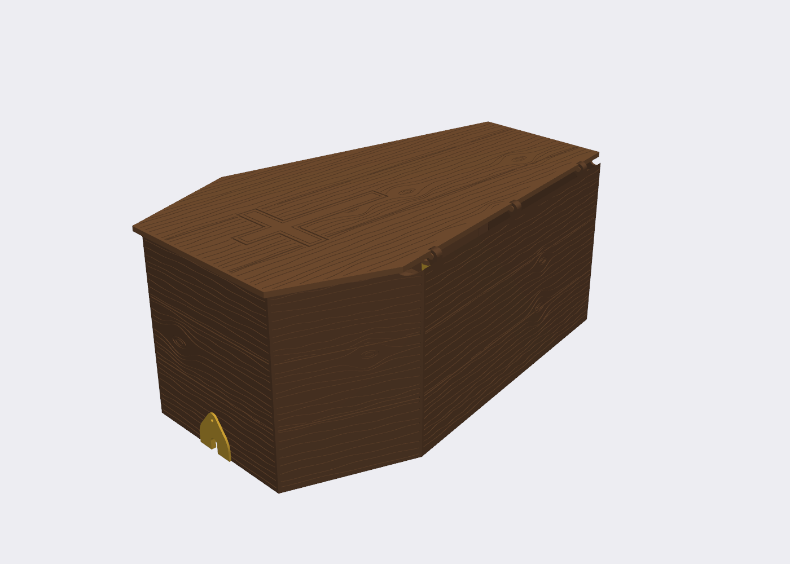

# Halloween builds

3D-printable Halloween props, designed in code with [CadQuery](https://cadquery.readthedocs.io/).

## Fog Coffin



A wood-grain coffin that sits over a fog machine in the yard. The lid props open on a printed hinge and ratchet stay to let low-lying fog roll out. It has no bottom, so it sits right on the grass, and there's a cord notch at each end.

- **Printer:** designed for a Bambu Lab H2C, 0.8 mm nozzle, PETG. Every part fits within 300 × 320 mm.
- **Prints:** 7 plates, about 1.45 kg of PETG.
- **Hardware:** 25 × M3×12 screws and nuts. The hinge needs none.
- **Size:** 430 × 260 × 185 mm outside. Fits a 230 × 130 × 150 mm fogger with 18 cm clear in front of the nozzle.

**Build notes, print settings and assembly:** [fog_coffin/README.md](fog_coffin/README.md)

### Regenerating the model

```bash
pip install cadquery trimesh shapely
cd fog_coffin
python3 export.py      # rewrites stl/, step_untextured/ and plates/ in place (~2 min)
python3 check.py       # bed-fit, interference and lid-swing checks
```

Every dimension lives in `PARAMS` at the top of `coffin.py`.

## License

Designs: CC BY-NC-SA 4.0 · Code: PolyForm Noncommercial 1.0.0. Personal use and remixes are welcome; commercial use isn't. See [LICENSE.md](LICENSE.md).
