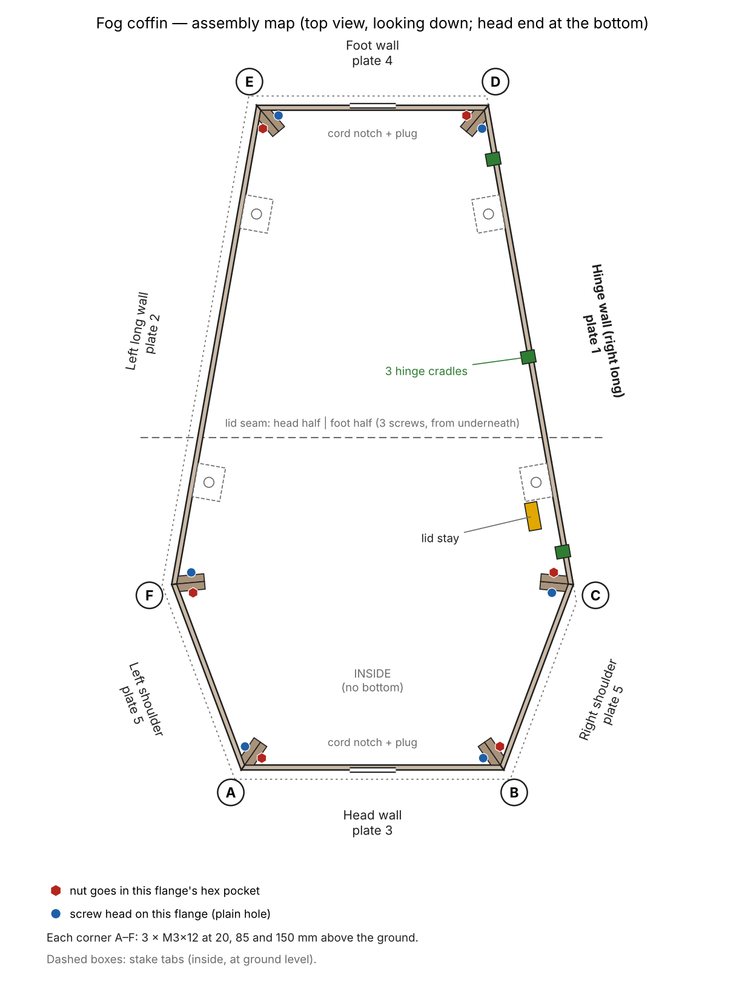

# Fog Coffin — assembly guide

**Orientation used throughout:** stand at the head end (the narrow end with the cross on the lid) and look toward the foot. The **hinge wall is on your right.** The corners are lettered **A–F** as on the map.

## What you need
| Item | Qty | Where it goes |
|---|---|---|
| M3×12 screws | 25 | 18 corners, 3 lid seam, 2 lid stay, 2 cord plugs |
| M3 hex nuts | 25 | one per screw |
| Printed stay washers (plate 4) | 2 | under the two lid-stay screw heads |
| 2.5 mm hex key (for socket-head M3) or a matching driver | 1 | |
| Masking tape | a little | holds nuts in their pockets while you work |
| Flat floor or table, and a towel | | keeps the ring flat and protects the lid's grain |

Parts by plate: **1** hinge wall · **2** left long wall · **3** head wall + 2 cord plugs · **4** foot wall + lid stay + 2 washers · **5** right and left shoulder walls · **6** lid head half · **7** lid foot half.

## 0. Prepare the parts
1. Snip off the corner tabs with flush cutters and clean the edges with a knife.
2. Test a screw in a few holes. If one is tight, run a 3.5 mm (9/64") drill bit through it by hand.
3. Test a nut in a few hex pockets. If a nut falls out, a strip of masking tape over the pocket holds it until the screw is in.
4. **Dry-assemble everything (steps 1–7) and test it over the fogger before painting.** Then take it apart, paint, and do the final assembly. Keep paint out of the hinge cradles, off the hinge pins and out of the nut pockets.

## How every corner joint works
Each wall has a flange on the inside face at each end. Two flanges meet back to back on the mitre line at every corner. One wall's flange has **hex pockets** and the other has **plain round holes**; every wall has pockets at one end and plain holes at the other.

- **Nuts** press into the hex pockets.
- **Screws** go through the plain holes, through both flanges, into the nuts.
- **3 screws per corner**, at 20, 85 and 150 mm above the ground. Everything is reached from inside the coffin.

| Corner | Walls that meet | Nuts go in | Screw heads on |
|---|---|---|---|
| **A** head, left | head wall + left shoulder | head wall | left shoulder |
| **B** head, right | head wall + right shoulder | right shoulder | head wall |
| **C** right shoulder | right shoulder + hinge wall | hinge wall | right shoulder |
| **D** foot, right | hinge wall + foot wall | foot wall | hinge wall |
| **E** foot, left | foot wall + left long wall | left long wall | foot wall |
| **F** left shoulder | left long wall + left shoulder | left shoulder | left long wall |

**Telling the two shoulder walls apart** (both print on plate 5): they're mirror images, and each fits only one way with the wood grain facing out. The **right** shoulder has its hex pockets at the head end (corner B). The **left** shoulder has its hex pockets at the shoulder end (corner F).

## 1. Build the head end (corners A and B)
1. Stand the head wall upright on the flat surface, grain facing out and cord notch at the bottom.
2. Put 3 nuts in the head wall's hex pockets at its left end (corner A) and tape them.
3. Stand the left shoulder against it at corner A. Screw through the left shoulder's plain holes into those nuts. **Finger-tight for now.**
4. Put 3 nuts in the right shoulder's pockets at its head end. Join it to the head wall at corner B, screwing through the head wall's plain holes. Finger-tight.

You now have a U shape that stands on its own.

## 2. Add the long walls (corners C and F)
1. **Hinge wall (right):** put 3 nuts in its pockets at the shoulder end (corner C). The hinge cradles go at the top, opening toward the inside. Screw through the right shoulder's plain holes. Finger-tight.
2. **Left long wall:** put 3 nuts in the **left shoulder's** pockets at corner F. Screw through the left long wall's plain holes. Finger-tight.

## 3. Close the ring with the foot wall (corners D and E)
1. Put 3 nuts in the foot wall's pockets at its right end (corner D) and 3 in the left long wall's pockets at its foot end (corner E).
2. Set the foot wall in place, cord notch at the bottom. Screw through the hinge wall's plain holes at D and the foot wall's plain holes at E.

## 4. Square it up and tighten
1. With the ring on the flat surface, press down on each corner so all six walls sit flat and none rocks.
2. Tighten the **middle** screw at each corner first, then the top and bottom ones.
3. Go **snug, not hard**: stop when the flanges are pulled tight together. Overtightening cracks PETG around the nut pockets.
4. Peel off the tape.

## 5. Cord plugs
Each plug's tongue fits into the notch from outside, with its flange against the outside of the wall. One screw goes from outside through the hole in the plug's flange, into a nut in the boss on the inside of the wall, just above the notch.

- **Head end** (closest to the fogger): the **slotted** plug, with the power cord running through the slot.
- **Foot end:** the **blank** plug.

Fit the head-end plug once the fogger is in place and the cord is through the notch (step 8).

## 6. Assemble the lid
1. Lay both lid halves **face down** on a towel, with the seam ribs underneath meeting at the split line. The head half has the cross.
2. Line up the outside edges and the hinge barrel so they're flush.
3. Put 3 nuts in the hex pockets on the **head-half** rib. Screw through the **foot-half** rib's plain holes into them. Snug.

## 7. Hang the lid on the hinge
1. Hold the lid open at about 80°, hinge edge toward the hinge wall.
2. Set its pins at the mouths of the three cradles on top of the hinge wall. The cradles open toward the inside of the coffin and slightly up.
3. Push the lid toward the hinge wall so the pins slide down into the cradles, then lower it closed. It should swing smoothly; brand-new pins feel snug and loosen after a few swings.

## 8. Fit the lid stay
The stay bar has a **round hole** at one end and a **long notched slot** at the other. It hangs inside the coffin near the head end of the hinge wall. Each pivot is a printed bushing (a short round post), on the lid's lug and on the wall's lug, that passes through the bar.

1. Prop the lid open.
2. **Lid end:** slide the bar's **round hole** onto the bushing on the lug under the lid. Put a printed washer on the screw and screw in from the side facing the foot, into a nut in the hex pocket on the lug's face toward the head end.
3. **Wall end:** slide the bar's **slot** onto the bushing on the hinge wall's lug. Washer + screw from the side facing the head, into a nut in the pocket on the lug's face toward the foot.
4. Tighten both fully. The screws clamp the bushings, not the bar, so it still swings freely.
5. Check it: lifting the lid, the stay should click into notches at about 30°, 55° and 80°, with a hard stop at 85°. To close, lift slightly, push the bottom of the stay toward the hinge wall so it slides past the notches, and lower.

## 9. Set it up outside
1. Put the fogger inside, centred, about 1 cm from the head wall, nozzle pointing toward the foot.
2. Run the cord out through the head notch and fit the slotted plug.
3. Ice goes in the foot section in a sealed bag or tray, at least 10 cm from the nozzle.
4. Stake the coffin through the four tabs at the bottom of the long walls with tent stakes or landscape staples.

## Taking it apart for storage
Do the steps in reverse. Remove one stay screw and lift the lid off the cradles. Undo the lid seam if you want it to pack flatter. Then unbolt corners D and E, then C and F, then A and B. Bag the screws and nuts together. **Store the lid flat and on its own**, since leverage on the hinge pins is what breaks them.

**Hinge pin repair:** if a pin breaks, drill the stub out at 5 mm and glue in a short piece of 5 mm rod.
